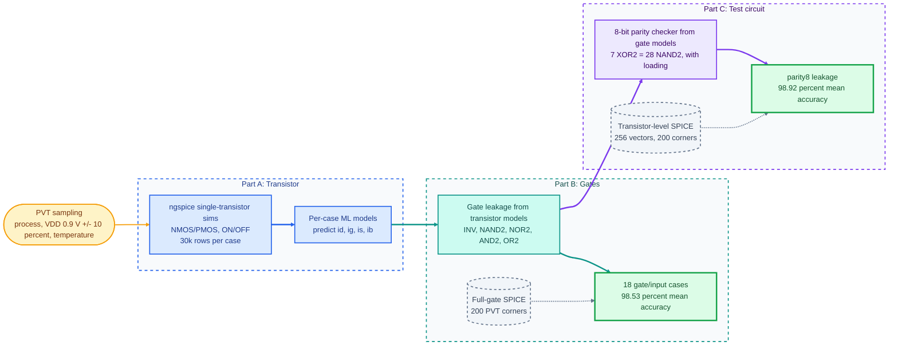

# ML-Driven PVT-Variation-Aware Leakage Estimation

> Course project, Digital VLSI Design.

## Team

| Name | Roll number |
|---|---|
| Manya | 2024102068 | 
| Joanna | 2024112008 |
| Sindhuja | 2024102055 |
| Gopal Kataria | 2023112006 | 

## Summary 



Static leakage of a CMOS circuit varies strongly with process (P), supply voltage (V) and
temperature (T), and simulating every PVT corner in SPICE is slow. This project trains machine-learning
models on single-transistor ngspice simulations, then reuses them to predict leakage hierarchically
at higher levels:

1. **Transistor (Part A):** SPICE data for four cases (NMOS/PMOS, ON/OFF) under random PVT
   variation. One model per case predicts all four terminal currents (`id, ig, is, ib`).
2. **Gates (Part B):** INV, NAND2, NOR2, AND2 and OR2 leakage for every input combination,
   built from the transistor models and checked against full-gate SPICE over 200 PVT corners.
3. **Test circuit (Part C):** an 8-bit odd-parity checker (7 XOR2 = 28 NAND2), all 256 input
   vectors × 200 corners, predicted from the gate models (including inter-gate loading) and
   checked against transistor-level SPICE.

| Result | Mean accuracy | Median error | p95 error |
|---|---:|---:|---:|
| Gates, all 18 gate/input cases × 200 corners | 98.53 % | 1.13 % | 4.13 % |
| Test circuit, 256 vectors × 200 corners | 98.92 % | 0.92 % | 2.91 % |


| Setting | Value |
|---|---|
| Model card | `pdk/32nm_LP.pm` (PTM 32 nm LP, BSIM4) |
| Nominal VDD | 0.9 V (±10 % in the PVT sampling) |
| Lmin | 32 nm (L = Lmin for every transistor) |
| Test circuit | 8-bit odd-parity checker (`parity8`) |
| Simulator | ngspice-47 |

All settings, sample counts and random seeds are in [`configs/project.yaml`](configs/project.yaml).

## Deliverables

The report is submitted separately on Moodle. Everything else is in this repository and is
regenerated by `make all`.

| # | Deliverable | Location |
|---|---|---|
| 1 | Datasets (NMOS ON/OFF, PMOS ON/OFF) | `data/transistor/{nmos_on,nmos_off,pmos_on,pmos_off}.csv` |
| 2 | Example netlists | `netlists/examples/`: `fet_*.sp` (one per case), `gate_*.sp` (one per gate), `circuit_parity8.sp` |
| 3 | Data check | `results/tables/kirchhoff.{csv,md}`; `results/plots/trend_ioff_vs_temp`, `trend_ioff_vs_vth0`, `trend_ig_vs_toxe` (`.png`/`.pdf`) |
| 4 | Model comparison (4 models × 4 cases, validation) | `results/tables/model_comparison.{csv,md}`, summary in `model_comparison_summary.{csv,md}`, tuning grid in `model_search.{csv,md}` |
| 5 | Chosen models | test errors in `results/tables/chosen_models_test.{csv,md}`; plots `results/plots/pred_vs_spice_{case}`; model files `artifacts/models/{case}.joblib` |
| 6 | Gate results table (18 gate/input cases) | `results/tables/gate_results.{csv,md}` (worst rows in `gate_worst_cases`) |
| 7 | Gate parity plot | `results/plots/gate_parity.{png,pdf}` |
| 8 | Test-circuit results and parity plot | `results/tables/circuit_results.{csv,md}`; `results/plots/circuit_parity.{png,pdf}` |
| 9 | Code | `scripts/00_*.py` … `scripts/12_*.py` (run in order by `make all`), library in `src/leakml/`, tests in `tests/` |

Also included:
- A learning curve: `results/tables/learning_curve.*`, `results/plots/learning_curve*`.
- The full per-row data for Parts B and C: `data/gates/`, `data/circuit/`, `data/corners.csv`.

**Dataset size:**  We use **30,000 rows per case**, because the learning curve showed the validation error still falling
at the 10k size.

**Reproducibility:** every random draw is seeded from `configs/project.yaml`:
- `transistor_data: 1001`
- `split: 42`
- `training: 7`
- `corners: 2026`

Rerunning `make all` gives the same data, models and results.

## Requirements

- Linux or macOS with GNU Make
- [ngspice](https://ngspice.sourceforge.io/) on `PATH` (results were produced with ngspice-47)
- [uv](https://docs.astral.sh/uv/), which installs Python 3.12 and the locked dependencies from
  `uv.lock`. The main ones are numpy, pandas, scipy, scikit-learn, LightGBM and matplotlib.

## Running

```bash
uv sync          # install Python 3.12 + locked dependencies
make check       # check ngspice, the model card and package versions
make test        # unit tests (+ lint: make lint)
make all         # full pipeline, steps 00 -> 12 (about 1 hour on 8 cores)
```

`make all` runs three stages, and each can also be run on its own:

| Target | Steps | What it does |
|---|---|---|
| `make partA` | 00–05b | transistor data, data check, model training/comparison, final models, learning curve |
| `make partB` | 06–09 | 200 PVT corners, gate SPICE, gate ML, gate tables and plots |
| `make partC` | 10–12 | circuit SPICE, hierarchical circuit ML, circuit tables and plots |

Pass `QUICK=1` for a small pilot run, e.g. `make partA QUICK=1`. Pilot runs write to `_pilot`
folders and never overwrite the deliverables.
